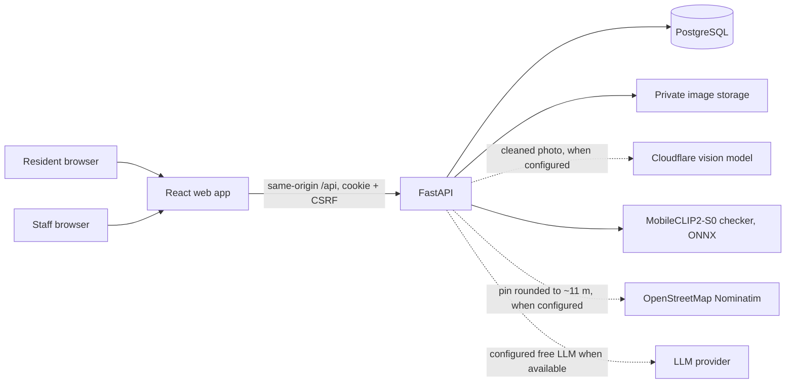
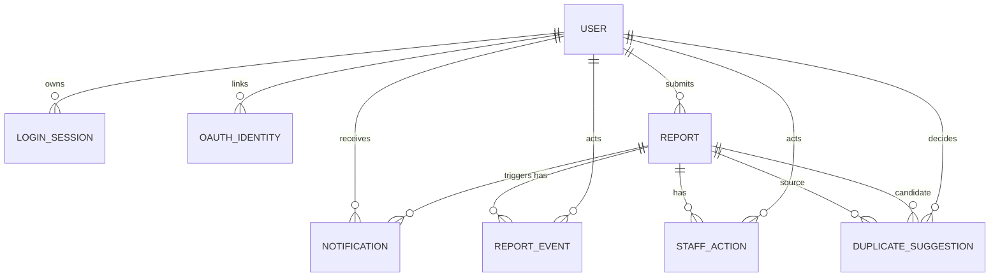

# Architecture and data flow

FastAPI alone decides ownership, roles, status changes, and access to original images. The browser sees only authenticated `/reports/{id}/image` responses. The model prediction, resident-selected category, and staff-verified category occupy distinct report fields. Model absence requires manual selection; staff still verifies all accepted reports. Chat report status uses a server-side scoped lookup, never a model-generated status.

`REPORT_EVENT` records actor and timestamp for each status change. `DUPLICATE_SUGGESTION` has a model version, score, decision, actor, and decision time; both original reports remain. Staff actions can record external coordination, but no API sends reports to another agency.

The selected Render container serves website and API under one origin. Supabase stores PostgreSQL rows and private photos. Sessions and authorization remain in FastAPI; Supabase client roles have no application-table policies. Storage credentials stay on the server, which checks report permissions before returning image bytes. Google identities map by provider and subject; matching password-account emails are not automatically linked.

## Status rules

`Pending` to `Under Verification` to `Accepted` to `In Progress` to `Resolved`. `Under Verification` may instead become `Rejected`. Acceptance requires a verified category. Residents can read their own reports and history; staff and administrators can read and update all reports.
